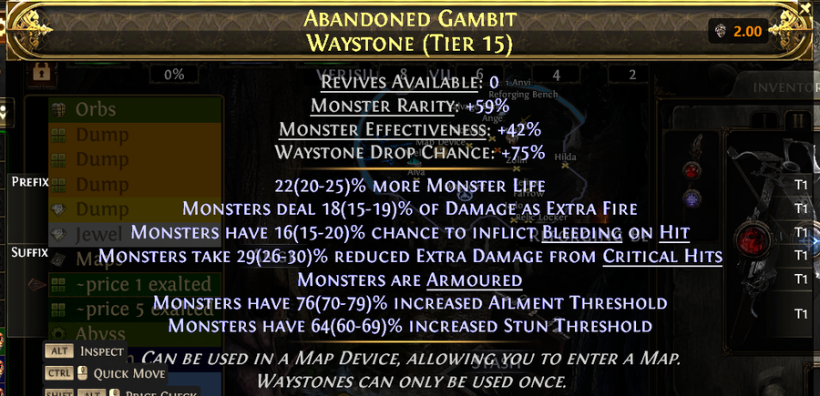
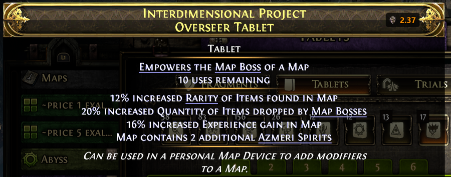

# poe2pricer

Price overlay for Path of Exile 2. It reads the game window from the screen and writes prices
from poe.ninja next to what it recognises. It presses no keys, clicks nothing and sends nothing
about you anywhere. What it does request: prices from poe.ninja and the item images they refer
to from web.poecdn.com, the community ratings of the island rumours from Gnejs PoE Tools and a
public Google sheet, waystone and tablet prices from the trade site of pathofexile.com (the
item's values and mods, nothing else), and, if you leave "Check for updates" on, once per start
the newest release from github.com.

| Ritual (Favours) | Expedition remnants |
|---|---|
|  |  |

| Stash tabs | Island Rumours |
|---|---|
|  |  |

| Waystone tooltip | Tablet tooltip |
|---|---|
|  |  |

## Features

- **Ritual window** (Favours): a price at every item in the grid, the best one marked. Items
  under a tooltip or a notification are left alone until it is gone.
- **Expedition remnant list** (Runeshape Combinations): a price at every reward row, with the
  stack ("3x Exalted Orb" is priced as three), and an arrow to the best reward when it is
  scrolled out of view. Skill rows ("Skill Level 20: …") have no market and get none.
- **Special stash tabs** (orbs, essences, breach, delirium, expedition, ritual, abyss, tablets,
  socketables): a price at every filled slot.
- **Island Rumours** panel of the Atlas: the community rating of each rumour next to its line,
  with your own ratings and notes on top. The panel shows three rumours at a time and rolls
  them anew when you move an item in the inventory; poe2pricer recognises the island by the sea
  chart around it and collects the rumours over the rolls: rumours seen before are listed
  under the table, new ones are marked, and an **expedition tier** sums the island up. Opening
  the panel again without moving anything shows the same three and counts as no roll; with
  three on the panel the card reminds you to move an item for more.
- **Waystones**: a tab in the program window. A profile names what a waystone must have:
  item rarity, pack size, monster rarity and effectiveness, drop chance, tier, revives,
  corrupted or not, and mods in groups as on the trade site ("and": every mod, "or": at least
  one, "not": none). From it come the search text for the game's stash search (copied with a
  click, it highlights the matching waystones) and the profile's price on the trade site
  ("Refresh price").
- **Tablets**: a tab like the Waystones tab, one profile per kind of tablet (Breach,
  Expedition, Delirium, Ritual, Irradiated, Overseer, Abyss, Temple): uses left at least this
  many, and the kind's mods in groups.
- **Live price at the tooltip** of a waystone or tablet under the mouse or cursor, switched on
  in Settings → Display: the price on the trade site, asked in the words of the closest
  profile with the item's own values (or exactly as the item is, without a profile), at the
  right end of the tooltip's title bar. Counted are Instant Buyout listings (with "incl.
  premium stash (online)" in Settings → Display also sellers who are online); with four or more
  listings the second cheapest, so that one price fixer does not count. `Alt+D` asks for the
  item exactly as it is.
- **Automatic**: with the automatic scan on, prices appear by themselves when one of these
  windows opens and go when it closes. Or by key: `Alt+F` shows and hides them.
- **Prices from poe.ninja**, refreshed every few minutes, in Exalted (or Chaos) and from one
  Divine on in Divine. The colour is the price band and follows the exchange rate: grey under
  0.02 div, white under 0.2 div, yellow under 1 div, orange from 1 div; the best item of a
  window is marked green. Marks instead of a price: "?" poe.ninja
  lists no price for the item; "<" below the price floor you choose; a red "!" a greyed-out
  omen whose kind the symbol alone does not tell (put the mouse or cursor on it, the program
  reads its tooltip and the price follows); "▲" or "▼" in the remnant list, the best reward is
  scrolled out of view in that direction. At a waystone's or tablet's tooltip: "…" the trade
  site is being asked, "–" it has no listing, "⏳" it is busy or not reachable (the status line
  says when it is asked again).
- **Keyboard and controller UI** of the game, **English and German** game client (waystones
  and tablets too: their tooltips are read in both languages, the search text is written in
  the client's), any window height (measured from 1080 to 2160 pixels), every Popup Size
  setting of the game.
- **No calibration.** Every window is found by a piece of the game's own art.
- **Runs in the notification area.** A click on the tray icon opens the settings window; the
  program can start with Windows and tells you when a newer version is out.
- **Settings window in English or German.**

## Download and install

1. Download from the [Releases](https://github.com/saxe78/poe2pricer/releases) page, one of
   the files below. Every release is built by GitHub Actions from its tag; `SHA256SUMS.txt` in
   the release and the public log of the run name the checksum of each file.
   - `poe2pricer-app-win-Setup.exe`: installs for your user account, no administrator rights,
     Start menu entry, uninstall through Windows, and **installs updates on a click**. Recommended.
   - `poe2pricer-<version>-win-x64.zip`: the same program to unpack anywhere, about 150 MB,
     no installation; it tells you about new versions but does not update itself.
   - `poe2pricer-<version>-win-x64-framework-dependent.zip`: smaller, needs the
     [.NET 10 Desktop Runtime](https://dotnet.microsoft.com/download/dotnet/10.0) installed.
2. Run the setup, or unpack the zip and start `poe2pricer.exe`. The setup installs to
   `%LOCALAPPDATA%\poe2pricer-app` (another folder only from the command line:
   `poe2pricer-app-win-Setup.exe --installto <folder>`); settings, log and diagnoses are in
   `%LOCALAPPDATA%\poe2pricer` for both ways. The installed folder holds the program in `current\`
   (replaced by every update), the updater `Update.exe` and a starter `poe2pricer.exe` that
   always starts the current version; the Start menu entry does the same. Apart from that, the program writes to the registry only the entry that
   starts it with Windows, if you tick that.
3. At the first start the program checks whether Windows has its **English (United States)
   text recognition**. If it is missing, the program offers to install it: Windows asks for
   administrator rights and downloads the language feature; that takes 3 to 10 minutes. If
   Windows has an update waiting for a restart, the program asks you to restart Windows first.

The first start opens the settings window. Every later start goes straight to the notification
area; a click on the tray icon brings the window back.

**SmartScreen and virus scanners.** The executable is not signed. Windows SmartScreen may warn
about an unknown publisher at the first start ("More info" → "Run anyway"), and a virus scanner
may flag a new, unsigned program. The source is in this repository; the installation of the
text recognition runs Windows' own `dism.exe`, no scripts.

Settings, the log and diagnoses live in `%LOCALAPPDATA%\poe2pricer`. Deleting the folder
resets the program.

## Use

- `Alt+F` shows or hides the prices for the window that is open in the game.
- With the automatic scan on (settings window), prices appear by themselves as soon as one of
  the windows opens.
- `Alt+Shift+F` saves a diagnosis to `%LOCALAPPDATA%\poe2pricer\diagnostics`: a screenshot and
  what the program made of it. Useful when reporting a wrong price; the screenshot shows your
  game as it was at that moment.
- `Alt+D` ("Force live price") at a waystone's or tablet's tooltip asks its price exactly as the
  item is, every value and every mod, past the profiles; also while the live price is switched
  off.
- The settings window has four tabs: **Settings** (league, keys, automatic scan and its
  windows, price floor, the unit prices are written in — Exalted or Chaos, Divine from one
  Divine on — the live price at waystone and tablet tooltips and which trade listings count,
  start with Windows, language), **Rumours** (the community table of
  island rumours, your own ratings and notes, and the weight of each tier for the expedition
  tier), **Waystones** (profiles for the stash search and the trade site, and the
  tolerance of the live price) and **Tablets** (the same per kind of tablet).
- Waystones and tablets: put the mouse or the cursor on one; with the live price switched on
  in the settings, its price stands at the title bar after a moment (the marks are explained
  under Features). The search text of the tab goes into the search box of the stash tab and
  highlights the items that match the profile.
- "Refresh prices" and "Exit" are in the settings window.

All three keys can be changed in the settings window.

## Requirements

- Windows 10 version 2004 (build 19041) or later, 64-bit.
- The Windows text recognition for English (United States); see above.
- Path of Exile 2 in **English or German**. In other game languages only the Ritual window and
  the stash tabs are read (they work on pictures, not on text).
- Game window with an aspect ratio of 16:10 or wider; any height (measured from 1080 to 2160
  pixels); any Popup Size setting of the game; any **UI Text Size** (large and extra large
  checked on pictures at 3440×1440, [issue #1](https://github.com/saxe78/poe2pricer/issues/1)).

## Known limits

- Larger UI Text Size settings are checked on one player's pictures (3440×1440, issue #1): all
  four windows read there. The program still notes the setting at the start; if a window shows
  gaps, a diagnosis helps.
- The compare view of the game (Ctrl held, tooltips side by side) draws tooltips at about 85 %
  size; they are not recognised. Release Ctrl before you press the key.
- Waystone and tablet tooltips are read with the Windows text recognition through the
  half-transparent tooltip: what is bright behind it can cost a line or a number. The program
  reads the tooltip several times and joins what it found; a tooltip over a calm background
  reads best.
- Aspect ratios narrower than 16:10 are not supported.
- In the Standard league poe.ninja lists no prices for most uniques; they show "?".
- Recognition relies on the game's current art and layout. A game update that changes a window
  may break it until the templates are updated.
- Island Rumours: the island is recognised by the sea chart around it. Dragging or zooming the
  Atlas between two openings of the panel, or switching between keyboard and controller (another
  zoom, another view), can leave too little of the chart in common: the Atlas is drawn in
  perspective, so a moved map shows the same island distorted differently, and the program then
  starts a new collection for the same island. Opening the panel without moving the Atlas (the
  usual rotation through the inventory) is always recognised.

## Troubleshooting

**No prices appear.** The window must be one of those above, the game in English or German
(the Ritual window and the stash tabs work in any language). Waystone and tablet tooltips need
the live price switched on in Settings → Display, and the "Stash" switch of the automatic scan
(or `Alt+F`). Press `Alt+F` once; with the automatic scan off, that is the only way. The log in
`%LOCALAPPDATA%\poe2pricer\log.txt` says what the program saw ("hidden: …" lines name the
reason).

**A price is wrong or missing.** Press `Alt+Shift+F` while it is on screen and open an issue
with the files from `%LOCALAPPDATA%\poe2pricer\diagnostics` (the picture shows your game at that
moment).

**"poe2pricer needs the English text recognition of Windows."** Let the program install it
(administrator rights, a few minutes), or install it yourself: Windows Settings → Time &
language → Language & region → Add a language → English (United States), with the optional
feature "Text recognition" ticked; or, as administrator,
`dism /Online /Add-Capability /CapabilityName:Language.OCR~~~en-US~0.0.1.0`. If Windows reports
that it needs a restart to finish, restart it through Settings → Windows Update → Restart now:
a restart from the Start menu may put the pending work off again.

**The overlay stays while the game is gone.** The overlay hides when the game window is not in
front. If it stays, press `Alt+F`.

**Windows SmartScreen or a virus scanner blocks the program.** See "Download and install".

## Updates

With "Check for updates" on (the default), the program asks github.com once at every start
whether a newer version is out.

- Installed with the setup: the status line and a tray message name the new version; a click
  on either downloads and installs it and starts poe2pricer again. Nothing is downloaded or
  installed without that click.
- Unpacked from a zip: the status line and a tray message tell you; a click opens the download
  page, and you unpack the new zip over the old folder or next to it.

Settings stay in `%LOCALAPPDATA%\poe2pricer` either way. The check can be switched off in the
settings window. What changed in each version: [CHANGELOG.md](CHANGELOG.md) and the notes of
each release on GitHub; a click on the version number in the program window opens the changelog
in your browser (the program itself requests nothing for that).

## Trust

What the program does and does not do, for anyone weighing whether to run it. The source is
here, about 17,000 lines of C#; the files that talk to the network are
`src/Poe2Pricer.Core/Market/*.cs`, `src/Poe2Pricer.Core/Rumours.cs` and
`src/Poe2Pricer.App/Updates.cs`.

- It reads the screen (the client area of the game window, by GDI) and draws over it. It
  presses no keys, clicks nothing and touches no other process. The one game file it reads is
  the game's own settings file, for the popup size, the text size and the client's language.
- It sends nothing about you. Its requests go to a fixed set of hosts, all HTTPS: poe.ninja (prices), web.poecdn.com (item art, only paths below that host whatever the
  price answer names), poe.gnejs.app and docs.google.com (rumour ratings; the sheet download is
  redirected to googleusercontent.com), api.github.com and github.com (the update check and the
  update itself; the release files come from release-assets.githubusercontent.com), and
  www.pathofexile.com (the trade site, for waystone and tablet prices: a search as a POST
  with the query as JSON — a profile's values or the item's — then a GET for the listings; only
  with the live price switched on in the settings, with `Alt+D`, or on "Refresh price" in the
  Waystones or Tablets tab, within the limits the site states in its answers, and after a
  failure only after a pause; without an account or session). An answer
  is read up to 32 MB, except the update package, which Velopack downloads.
- It has a low-level keyboard hook; that is how Alt+F can work while the game has the focus.
  The hook sees every key press, compares it with the three bound keys and passes everything else
  on unchanged. Nothing is stored or sent.
- The updater is Velopack fetching the releases of this repository; the binaries are not
  signed. The trust is the same as when you download the exe from the releases page yourself:
  whoever controls this GitHub account. "Check for updates" can be switched off; with it on,
  nothing is downloaded or installed until you click the message; a zip copy never updates
  itself.
- The item art it downloads is the one place where data from the network meets a parser. It
  is decoded by the Windows Imaging Component, the decoder of the Explorer and the browsers,
  patched with Windows, not by the one OpenCV ships; and only after the file's header has
  passed (a PNG with an alpha channel, at most 1024 pixels a side).
- The only step with administrator rights is installing the Windows text recognition with
  `dism.exe`, and it asks first.
- What it keeps, all under `%LOCALAPPDATA%\poe2pricer`: your settings (with the waystone and
  tablet profiles), a log of its own
  doings, the price cache, the item art and the rumour table. No picture of your game is
  written unless you press the diagnostics key. A diagnosis is a picture of the game window and
  a JSON with your settings (without the file paths in them, which carry your Windows user
  name) and what was read. "Extended diagnostics" (off by default) adds a few pictures of
  windows the program had trouble with.

## Build from source

Needs the .NET 10 SDK on Windows 10 version 2004 or later.

```
dotnet build src/Poe2Pricer.App -c Release
```

The program is then in `src/Poe2Pricer.App/bin/Release/net10.0-windows10.0.19041.0/` under the
repository folder (the default output place of the build). Everything it needs lies beside the
executable (`data/`). For a folder to ship:

```
dotnet publish src/Poe2Pricer.App -c Release -r win-x64 --self-contained true -o <folder>
```

The setup is packed from that folder with [Velopack](https://velopack.io)'s `vpk` tool
(`dotnet tool install -g vpk`); `tools/build_release.py` does publish, zips and setup in one go.

`poe2pricer.exe --render <picture> <output>` draws the overlay onto a screenshot (this is how
the pictures above were made).

## How the recognition works

Every window is found by a piece of the game's own art (an anchor) at a known place, so the
program needs no calibration. Items in the Ritual grid are recognised against the catalogue
pictures; stash slots against the poe.ninja item art; remnant rows, tooltip titles and the lines
of waystone and tablet tooltips are read with Windows OCR and matched against the known lines
from the game files; rumour lines are matched as pictures against the game's texts drawn in the
game's handwriting. Popups of the game (tooltips, notifications, the confirmation dialog) are
found by their art and whatever lies under them is not trusted.

All thresholds and measures are in `src/Poe2Pricer.Core/Tuning.cs`, each with the reason it
stands where it stands. They were measured on game pictures at window heights from 1080 to 2160
and at every Popup Size of the game.

## Tech

.NET 10, WPF (overlay and settings window), Windows Forms (tray icon), OpenCvSharp (template
matching), Windows.Media.Ocr (text recognition), the Windows Imaging Component (decoding the
item art), CommunityToolkit.Mvvm, Velopack (setup and self-update), the poe.ninja API, a Win32
keyboard hook of its own. Screen capture by GDI.

## Data from the game

`data/catalog` (item pictures and names), `data/ui` (pieces of the game's interface used as
templates), `data/names` (German item names), `data/waystones` and `data/tablets` (the mod lines
in English and German, with the trade site's ids; `tools/waystone_mods.py`,
`tools/tablet_mods.py`) and the rumour texts are material of Grinding Gear Games, taken from the game files or from poe2db.tw and web.poecdn.com. The pictures above are
cut-outs of the game with the overlay drawn on. See `THIRD_PARTY_NOTICES.md` for this and for
the licences of the libraries and fonts used.

## Acknowledgements

- [Dev-Jahn/poe2-ritual-checker](https://github.com/Dev-Jahn/poe2-ritual-checker) (MIT): the
  recognition of the Ritual window started from it.
- [poe.ninja](https://poe.ninja): the prices and the item art. Unofficial use of its API.
- [Gnejs PoE Tools](https://poe.gnejs.app/poe2/expedition/rumours) and the public "Expedition
  Cheatsheet" sheet: the community ratings of the island rumours, loaded at run time.
- [pedro-quiterio/PoeAncientsPriceHelper](https://github.com/pedro-quiterio/PoeAncientsPriceHelper),
  [Exiled Exchange 2](https://github.com/Kvan7/Exiled-Exchange-2) and Sidekick: looked at for
  how an overlay for this game behaves. No code was taken.
- Libraries and fonts: see `THIRD_PARTY_NOTICES.md`.

## About the development

poe2pricer was written with an AI coding assistant (Claude by Anthropic). The design, the
measurements on game pictures, the decisions and the testing in the game are the author's.

## Licence

MIT, see `LICENSE`.
