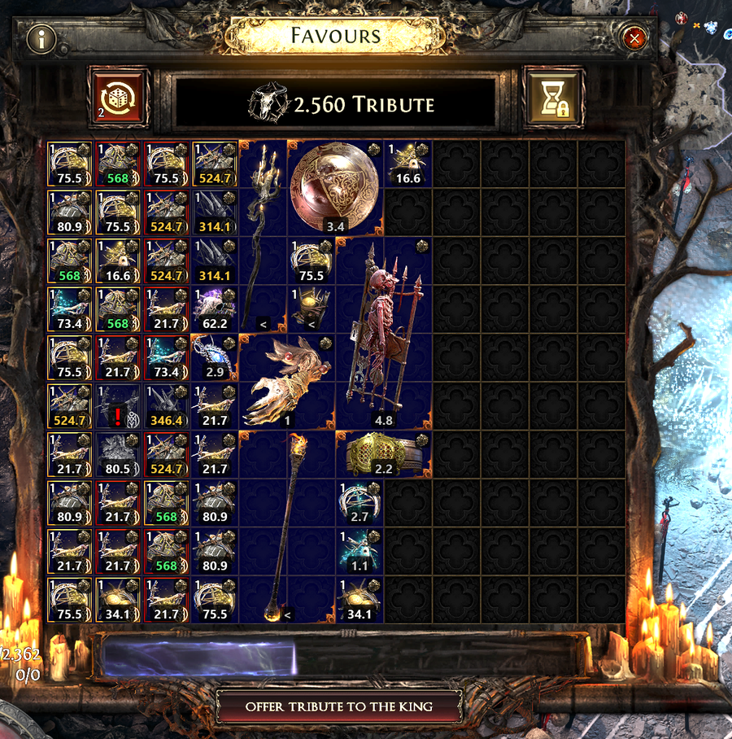
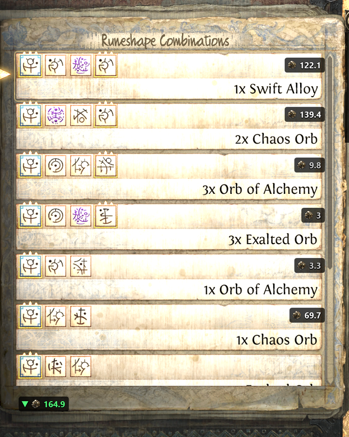
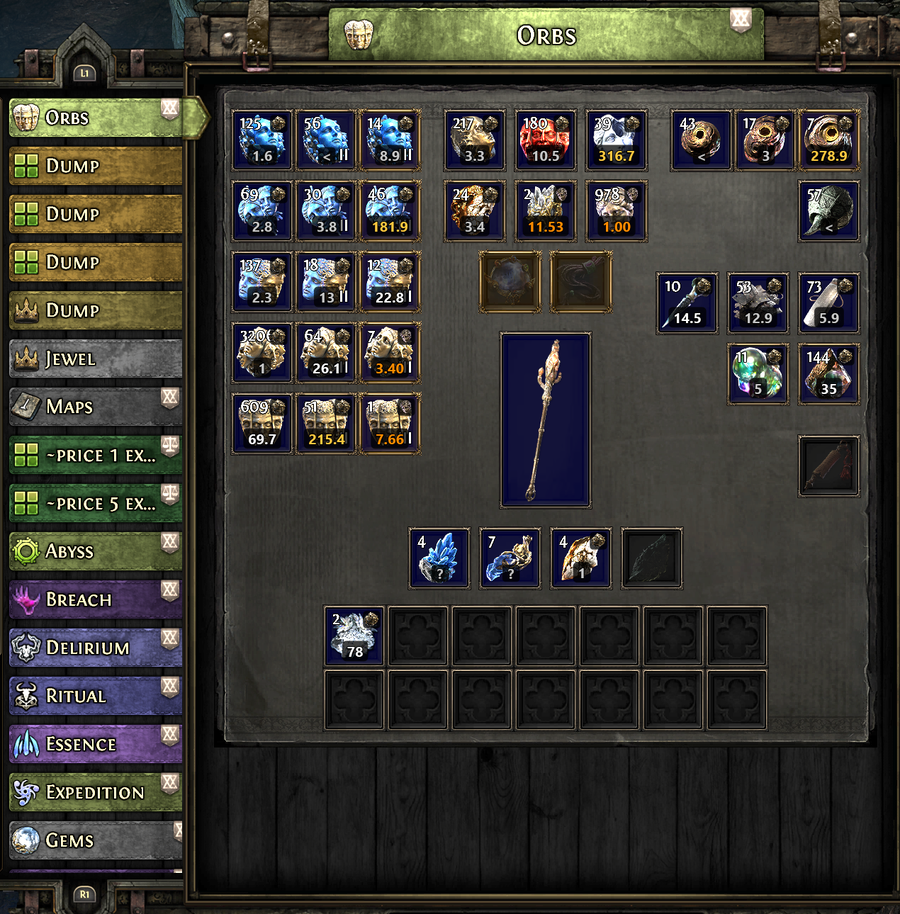
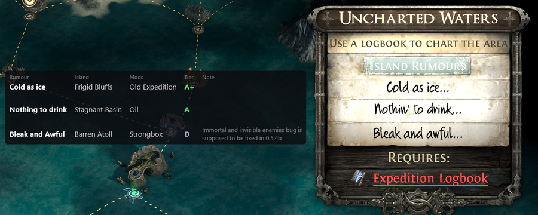

# poe2pricer

Price overlay for Path of Exile 2. It reads the game window from the screen and writes prices
from poe.ninja next to what it recognises. It presses no keys, clicks nothing and sends nothing
about you or your game anywhere. What it does request: prices from poe.ninja, the community
ratings of the island rumours from Gnejs PoE Tools and a public Google sheet, and, if you leave
"Check for updates" on, once per start the newest release from github.com.

| Ritual (Favours) | Expedition remnants |
|---|---|
|  |  |

| Stash tabs | Island Rumours |
|---|---|
|  |  |

## Features

- **Ritual window** (Favours): a price at every item in the grid, the best one marked. Items
  under a tooltip or a notification are left alone until it is gone.
- **Expedition remnant list** (Runeshape Combinations): a price at every reward row, with the
  stack ("3x Exalted Orb" is priced as three), and an arrow to the best reward when it is
  scrolled out of view. Skill rows ("Skill Level 20: …") have no market and get none.
- **Special stash tabs** (orbs, essences, breach, delirium, expedition, ritual, abyss, tablets,
  socketables): a price at every filled slot.
- **Island Rumours** panel of the Atlas: the community rating of each rumour next to its line,
  with your own ratings and notes on top.
- **Automatic**: with the automatic scan on, prices appear by themselves when one of these
  windows opens and go when it closes. Or by key: `Alt+F` shows and hides them.
- **Prices from poe.ninja**, refreshed every few minutes. Marks instead of a price: "?" poe.ninja
  lists no price for the item; "<" below the price floor you choose; a red "!" a greyed-out
  omen whose kind the symbol alone does not tell (put the mouse or cursor on it, the program
  reads its tooltip and the price follows); "▲" or "▼" in the remnant list, the best reward is
  scrolled out of view in that direction.
- **Keyboard and controller UI** of the game, **English and German** game client, any window
  height (measured from 1080 to 2160 pixels), every Popup Size setting of the game.
- **No calibration.** Every window is found by a piece of the game's own art.
- **Runs in the notification area.** A click on the tray icon opens the settings window; the
  program can start with Windows and tells you when a newer version is out.
- **Settings window in English or German.**

## Download and install

1. Download from the [Releases](https://github.com/saxe78/poe2pricer/releases) page, one of:
   - `poe2pricer-app-win-Setup.exe`: installs for your user account, no administrator rights,
     Start menu entry, uninstall through Windows, and **updates itself**. Recommended.
   - `poe2pricer-<version>-win-x64.zip`: the same program to unpack anywhere, about 150 MB,
     no installation; it tells you about new versions but does not update itself.
   - `poe2pricer-<version>-win-x64-framework-dependent.zip`: smaller, needs the
     [.NET 10 Desktop Runtime](https://dotnet.microsoft.com/download/dotnet/10.0) installed.
2. Run the setup, or unpack the zip and start `poe2pricer.exe`. The setup installs to
   `%LOCALAPPDATA%\poe2pricer-app` (another folder only from the command line:
   `poe2pricer-app-win-Setup.exe --installto <folder>`); settings, log and diagnoses are in
   `%LOCALAPPDATA%\poe2pricer` for both ways. Apart from that, the program writes to the registry only the entry that
   starts it with Windows, if you tick that.
3. At the first start the program checks whether Windows has its **English (United States)
   text recognition**. If it is missing, the program offers to install it: Windows asks for
   administrator rights and downloads the language feature; that takes 3 to 10 minutes. If
   Windows has an update waiting for a restart, the program asks you to restart Windows first.

The first start opens the settings window. Every later start goes straight to the notification
area; a click on the tray icon brings the window back.

**SmartScreen and virus scanners.** The executable is not signed. Windows SmartScreen may warn
about an unknown publisher at the first start ("More info" → "Run anyway"), and a virus scanner
may flag a new, unsigned program. The source is in this repository; the installation of the
text recognition runs Windows' own `dism.exe`, no scripts.

Settings, the log and diagnoses live in `%LOCALAPPDATA%\poe2pricer`. Deleting the folder
resets the program.

## Use

- `Alt+F` shows or hides the prices for the window that is open in the game.
- With the automatic scan on (settings window), prices appear by themselves as soon as one of
  the windows opens.
- `Alt+Shift+F` saves a diagnosis to `%LOCALAPPDATA%\poe2pricer\diagnostics`: a screenshot and
  what the program made of it. Useful when reporting a wrong price; the screenshot shows your
  game as it was at that moment.
- The settings window has two tabs: **Settings** (league, keys, automatic scan and its
  windows, price floor, start with Windows, language) and **Rumours** (the community table of
  island rumours, your own ratings and notes).
- "Refresh prices" and "Exit" are in the settings window.

Both keys can be changed in the settings window.

## Requirements

- Windows 10 version 2004 (build 19041) or later, 64-bit.
- The Windows text recognition for English (United States); see above.
- Path of Exile 2 in **English or German**. In other game languages only the Ritual window and
  the stash tabs are read (they work on pictures, not on text).
- Game window with an aspect ratio of 16:10 or wider; any height (measured from 1080 to 2160
  pixels); any Popup Size setting of the game. **UI Text Size** must be the game's standard
  setting.

## Known limits

- Larger UI Text Size settings of the game are not supported; the program says so at the start.
- Aspect ratios narrower than 16:10 are not supported.
- In the Standard league poe.ninja lists no prices for most uniques; they show "?".
- Recognition relies on the game's current art and layout. A game update that changes a window
  may break it until the templates are updated.

## Troubleshooting

**No prices appear.** The window must be one of the four above, the game in English or German
(the Ritual window and the stash tabs work in any language), UI Text Size at the standard
setting. Press `Alt+F` once; with the automatic scan off, that is the only way. The log in
`%LOCALAPPDATA%\poe2pricer\log.txt` says what the program saw ("hidden: …" lines name the
reason).

**A price is wrong or missing.** Press `Alt+Shift+F` while it is on screen and open an issue
with the files from `%LOCALAPPDATA%\poe2pricer\diagnostics` (the picture shows your game at that
moment).

**"poe2pricer needs the English text recognition of Windows."** Let the program install it
(administrator rights, a few minutes), or install it yourself: Windows Settings → Time &
language → Language & region → Add a language → English (United States), with the optional
feature "Text recognition" ticked; or, as administrator,
`dism /Online /Add-Capability /CapabilityName:Language.OCR~~~en-US~0.0.1.0`. If Windows reports
that it needs a restart to finish, restart it through Settings → Windows Update → Restart now:
a restart from the Start menu may put the pending work off again.

**The overlay stays while the game is gone.** The overlay hides when the game window is not in
front. If it stays, press `Alt+F`.

**Windows SmartScreen or a virus scanner blocks the program.** See "Download and install".

## Updates

With "Check for updates" on (the default), the program asks github.com once at every start
whether a newer version is out.

- Installed with the setup: the new version is downloaded in the background and installed when
  you quit poe2pricer, or at once when you click the message in the status line or in the tray.
- Unpacked from a zip: the status line and a tray message tell you; a click opens the download
  page, and you unpack the new zip over the old folder or next to it.

Settings stay in `%LOCALAPPDATA%\poe2pricer` either way. The check can be switched off in the
settings window.

## Build from source

Needs the .NET 10 SDK on Windows 10 version 2004 or later.

```
dotnet build src/Poe2Pricer.App -c Release
```

The program is then in `src/Poe2Pricer.App/bin/Release/net10.0-windows10.0.19041.0/` under the
repository folder (the default output place of the build). Everything it needs lies beside the
executable (`data/`). For a folder to ship:

```
dotnet publish src/Poe2Pricer.App -c Release -r win-x64 --self-contained true -o <folder>
```

The setup is packed from that folder with [Velopack](https://velopack.io)'s `vpk` tool
(`dotnet tool install -g vpk`); `tools/build_release.py` does publish, zips and setup in one go.

`poe2pricer.exe --render <picture> <output>` draws the overlay onto a screenshot (this is how
the pictures above were made).

## How the recognition works

Every window is found by a piece of the game's own art (an anchor) at a known place, so the
program needs no calibration. Items in the Ritual grid are recognised against the catalogue
pictures; stash slots against the poe.ninja item art; remnant rows and tooltip titles are read
with Windows OCR; rumour lines are matched as pictures against the game's texts drawn in the
game's handwriting. Popups of the game (tooltips, notifications, the confirmation dialog) are
found by their art and whatever lies under them is not trusted.

All thresholds and measures are in `src/Poe2Pricer.Core/Tuning.cs`, each with the reason it
stands where it stands. They were measured on test pictures at window heights from 1080 to 2160
and at every Popup Size of the game.

## Tech

.NET 10, WPF (overlay and settings window), Windows Forms (tray icon), OpenCvSharp (template
matching), Windows.Media.Ocr (text recognition), CommunityToolkit.Mvvm, Velopack (setup and
self-update), the poe.ninja API, a Win32 keyboard hook of its own. Screen capture by GDI.

## Data from the game

`data/catalog` (item pictures and names), `data/ui` (pieces of the game's interface used as
templates), `data/names` (German item names) and the rumour texts are material of Grinding Gear
Games, taken from the game files or from poe2db.tw and web.poecdn.com. The pictures above are
cut-outs of the game with the overlay drawn on. See `THIRD_PARTY_NOTICES.md` for this and for
the licences of the libraries and fonts used.

## Acknowledgements

- [Dev-Jahn/poe2-ritual-checker](https://github.com/Dev-Jahn/poe2-ritual-checker) (MIT): the
  recognition of the Ritual window started from it.
- [poe.ninja](https://poe.ninja): the prices and the item art. Unofficial use of its API.
- [Gnejs PoE Tools](https://poe.gnejs.app/poe2/expedition/rumours) and the public "Expedition
  Cheatsheet" sheet: the community ratings of the island rumours, loaded at run time.
- [pedro-quiterio/PoeAncientsPriceHelper](https://github.com/pedro-quiterio/PoeAncientsPriceHelper),
  [Exiled Exchange 2](https://github.com/Kvan7/Exiled-Exchange-2) and Sidekick: looked at for
  how an overlay for this game behaves. No code was taken.
- Libraries and fonts: see `THIRD_PARTY_NOTICES.md`.

## About the development

poe2pricer was written with an AI coding assistant (Claude by Anthropic). The design, the
measurements on game pictures, the decisions and the testing in the game are the author's.

## Licence

MIT, see `LICENSE`.
